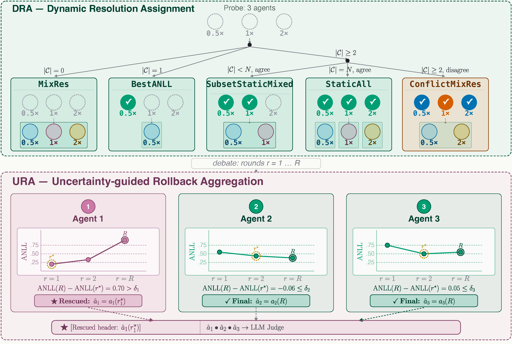

# DREAM: Dynamic Resolution Assignment Multimodal Multi-Agent Debate



DREAM is a unified and extensible benchmark for evaluating Multi-Agent Debate (MAD) methods across **M**ulti-domain tasks, **M**ulti-modal inputs, and **M**ulti-dimensional metrics — and a dynamic resolution-assignment strategy that lets debating agents spend vision-token budget only where it's needed. We provide a reproducible codebase, standardized protocols, and comprehensive analyses so researchers can study MAD at scale with consistent settings.

- Covering five core task domains: **Knowledge**, **Mathematics**, **Medicine**, **Natural Sciences**, and **Complex Reasoning**.
- Including 13 datasets (7 text-only, 6 multimodal) so researchers can perform controlled vision-language vs. pure-text comparisons.
- Supporting lots of base models with diverse architectures, scales, and modality capabilities.
- Measuring accuracy alongside cost-oriented metrics (token consumption, inference latency) to expose performance–cost trade-offs.
- **Dynamic Resolution Assignment (DRA):** a per-sample gating mechanism that probes agents at low image resolution first and only routes uncertain agents up to higher resolution — cutting redundant vision-token cost without sacrificing accuracy.

---

## Repository Layout

```
├── datasets/                 # Dataset builders and processed JSON files
├── methods/                  # MAD, DMAD, CoT, IO, LLM-Debate, Self-Consistency implementations
│   ├── mad_base/             # Shared MAD base class (config loading, model orchestration, logging)
│   ├── gating_utils.py       # Dynamic Resolution Assignment (DRA) gating decision logic
│   ├── div_mad/               # Div-MAD method (renamed from MAD)
│   ├── dmad/                  # Diverse MAD (DMAD)
│   ├── cot/                   # CoT baseline
│   ├── io/                    # Direct IO baseline
│   ├── llm_debate/            # LLM Debate baseline
│   └── self_consistency/      # Self-consistency baseline
├── evaluations/              # LLM-judge (X-Verify) based answer verification
├── model_api_configs/        # API endpoints for local/remote models
├── local_api_server/         # Example LLaMA-Factory/vLLM deploy configs for local models
├── results/                  # Default output directory for JSONL traces/stats (local symlink target)
├── utils/                    # Shared utilities (plotting, evaluation helpers, visual annotation, etc.)
├── inference.py               # Entry point for evaluating MAD methods
├── evaluate.py                 # Post-hoc answer verification / scoring
├── parse_results.py            # Aggregate JSONL traces + stats into summary tables
├── analyze_gated_strategy.py    # Analyze DRA routing decisions across a results set
├── render_scientific_figures.py # Paper-style figure generation from parsed results
├── env.yaml                    # Reproducible Conda environment
└── run_*.sl                    # Example SLURM job templates (cluster-specific, adapt as needed)
```

---

## 1. Environment Setup

We recommend Conda (or Mamba) for dependency management:

```bash
conda env create -f env.yaml
conda activate m3mad
```

The environment includes OpenAI-compatible clients, vision-language dependencies, and experiment tooling.

---

## 2. Dataset Preparation

Use the helper script to build any supported dataset:

```bash
python datasets/build_test_dataset.py --dataset_name <dataset_name>

# examples
python datasets/build_test_dataset.py --dataset_name MMLU
python datasets/build_test_dataset.py --dataset_name MathVision
```

The builder normalizes formatting and produces `datasets/data/<dataset>.json`. `scripts/parse_ds.sh` builds every supported dataset in one pass. Add new datasets by contributing to the builder script and documenting the corresponding JSON schema.

---

## 3. Model & API Configuration

DREAM interacts with models through a simple OpenAI-compatible interface.

1. **Configure API endpoints** in `model_api_configs/model_api_config.json`. Each top-level key is a `--model_name` alias; its value has:
   - `model_list`: one or more `{"model_name", "model_url", "api_key"}` entries (multiple entries let you load-balance a model across several endpoints).
   - `max_workers_per_model`: concurrency cap for that alias.
   - `supports_logprobs` (optional, default `true`): set to `false` for proxy/API models that don't expose logprobs — DRA then falls back to a self-reported confidence line instead of computing ANLL from logprobs directly.

   Real endpoints use a placeholder `"api_key": "XXXXXX"` (fill in your own); locally-served models use `"api_key": "local"`.

2. **Deploy local models (optional)** using [LLaMA-Factory](https://github.com/hiyouga/LLaMA-Factory) or vLLM directly. `local_api_server/` ships ready-made configs for ~15 models (Qwen2.5 / Qwen2.5-VL / Qwen3, InternVL3, LLaMA-3.1, LLaVA-NeXT, xVerify, etc.):
   ```bash
   git clone --depth 1 https://github.com/hiyouga/LLaMA-Factory.git
   cd LLaMA-Factory
   pip install -e ".[torch,metrics]"
   API_PORT=8000 CUDA_VISIBLE_DEVICES=0 \
     llamafactory-cli api ../DREAM/local_api_server/qwen2.5_vl_7b.yaml
   ```
   `scripts/start_vllm.py` / `scripts/start_llamafactory.py` automate picking a free port and updating `model_api_config.json` accordingly.
3. Register the endpoint in `model_api_config.json` (example: `"qwen2.5-vl-7b-local"`). Any OpenAI-compatible host, including cloud APIs, can be used.

---

## 4. Running Experiments

### 4.1 Debug Mode

```bash
python inference.py --method_name <method> --debug
```

This prints intermediate debate steps and token usage for quick sanity checks. `scripts/debug_interactive.sh` wraps this into an interactive prompt for picking method/dataset/model/config on the fly.

### 4.2 Full Inference

```bash
python inference.py \
  --model_name qwen2.5-vl-7b-local \
  --method_name div_mad \
  --test_dataset_name MMLU \
  [--method_config_name config_main_gated] \
  [--sequential] \
  [--output_path ./results/...jsonl]
```

Key arguments:

- `--model_name`: must match a key in `model_api_config.json`.
- `--method_name`: one of `div_mad`, `dmad`, `llm_debate`, `cot`, `io`, or `self_consistency`.
- `--method_config_name`: optional YAML under `methods/<method>/configs/`.
- `--sequential`: force single-threaded evaluation; otherwise, we parallelize using the configured worker pool.
- `--require_val`: load `<dataset>_val.json` and call `optimizing()` before inference if the method defines it.
- `--seed`: random seed passed through to the LLM API for reproducible sampling.
- `--teacher_ref_db_path`: overrides the method config's teacher-reference database path for distillation-style prompting, if the method uses one.
- `--debug_query` / `--sample_idx`: debug a single custom query, or a specific index from the loaded dataset, without running the full split.

Outputs include per-sample JSONL traces and a `*_stats.json` summary (token counts, runtime, etc.). Use `evaluate.py` / `evaluations/evaluate_xverify.py` for LLM-judge scoring and `parse_results.py` to aggregate traces into summary tables.

### 4.3 Batch / Cluster Examples

`scripts/run_mm.sh` and `scripts/run_sm.sh` sweep a method × dataset × seed grid for multimodal and text-only datasets respectively; `scripts/run_eval.sh` runs X-Verify-based scoring over a results directory. The root `run_mm.sl`, `run_mm_api.sl`, `run_mm_no_history.sl`, and `run_eval.sl` are example SLURM job templates built on top of them — adapt the `#SBATCH` directives (partition, GPU type, module names) to your own cluster.

---

## 5. Dynamic Resolution Assignment (DRA)

DRA is a per-sample gating strategy for multimodal debate: instead of running every agent at a fixed image resolution for every round, each agent first runs a cheap **probe round** at a low resolution, and an uncertainty score decides whether it needs to be routed to a higher resolution for the actual debate.

- **Uncertainty scoring:** each probe response gets an ANLL (average negative log-likelihood) score, computed from token logprobs when the backend exposes them, or parsed from a self-reported `Confidence: XX%` line (see `mad_base.py`'s confidence-elicitation prompt) for proxy/API backends where `supports_logprobs: false`.
- **Routing decision** (`methods/gating_utils.py::gated_resolution_decision`): agents with ANLL below a threshold are "confident." Depending on how many agents are confident and whether they agree, the sample is routed to one of:
  - `consensus_scaling` — agents converge onto a single (or small mixed) resolution: `static_all` (all confident, keep resolutions), `best_anll` (lock everyone to the most confident agent's resolution), `subset_static_mixed` (confident agents keep their resolution, unconfident agents get a mixed-resolution retry), or `conflict_mix_res` (confident agents disagree — scale to the resolution set of the majority answer).
  - `mix_res` — fewer than one confident agent: keep the original heterogeneous resolution mix and proceed.
- **Threshold:** static (`gated_anll_threshold` in the method config) or **adaptive** (`adaptive_threshold: true`), where the threshold is computed per-sample as `tau = mu_ANLL - sigma_ANLL` over that sample's probe-round ANLL distribution — calibrating to how hard the sample looks rather than using one fixed cutoff for every sample.

Relevant configs (under `methods/{div_mad,dmad,llm_debate}/configs/`):

| Config | Purpose |
| --- | --- |
| `config_main_gated.yaml` | Static-threshold DRA gating |
| `config_main_gated_adaptive.yaml` | Sample-adaptive threshold DRA gating |
| `config_main_consensus.yaml` | Consensus-only scaling (no probe-gated routing) |
| `config_perceiver_only.yaml` / `config_perceiver_no_probe.yaml` | Perceiver-based resolution selection, with/without the probe round |
| `config_ablation_th_0.10/0.20/0.30/0.50.yaml` | Static-threshold sweep |
| `config_ablation_scale_4x/high/low.yaml` | Resolution-scale sweep |
| `config_ablation_gated_adaptive_no_history.yaml` | Adaptive gating without cross-round history aggregation |

After a run, `analyze_gated_strategy.py` summarizes routing-decision statistics (which strategy fired, how often, at what accuracy/cost) and `render_scientific_figures.py` turns those summaries into paper-style plots.

---

## 6. Adding New MAD Variants

1. Create a new subdirectory under `methods/` following the structure used by `div_mad` and `dmad`.
2. Inherit from `methods.mad_base.MAD` to obtain configuration loading, model orchestration, and logging utilities.
3. Register the method name in `methods/__init__.py`.
4. Provide example configs in `methods/<method>/configs/` and update this README (or your paper) with any caveats.

---

## 7. Benchmark Dimensions & Metrics

- **Multi-Domain Coverage:** Knowledge, Mathematics, Medicine, Natural Sciences, and Complex Reasoning.
- **Multi-Modal Support:** Balanced suite of text-only and vision–language datasets enables controlled modality comparisons.
- **Multi-Dimensional Evaluation:** Accuracy, token consumption, and inference latency. Raw logs make it easy to derive further metrics (e.g., debate rounds, judge agreement, DRA routing decisions).
- **Model Diversity:** Multiple series of base models covering open-source and API endpoints; plug in any OpenAI-compatible backend.

Happy debating! 🗣️🤝📊

## Cite us
```
@misc{li2026dreamdynamicresolutionassignment,
      title={DREAM: Dynamic Resolution Assignment Multimodal Multi-Agent Debate}, 
      author={KBN},
      year={2026},
      eprint={},
      archivePrefix={arXiv},
      primaryClass={cs.AI},
      url={TBU}, 
}
```
---

## Acknowledgements

* [M3MAD-Bench](https://github.com/liaolea/M3MAD-Bench)
* [vLLM](https://github.com/vllm-project/vllm)